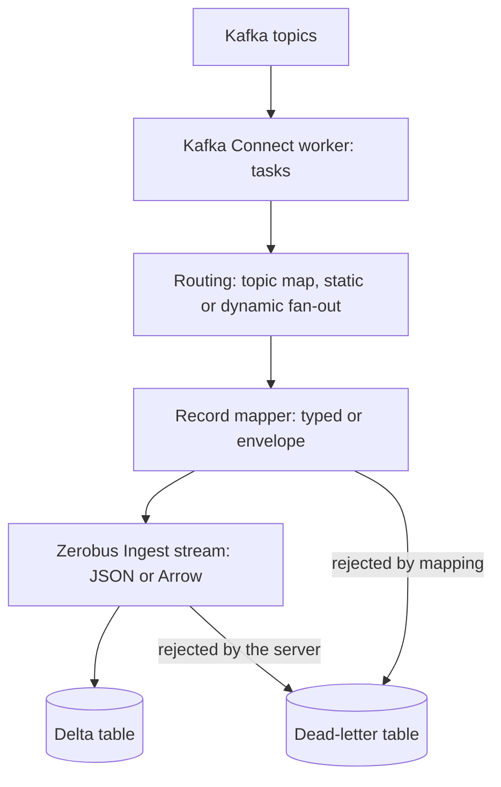
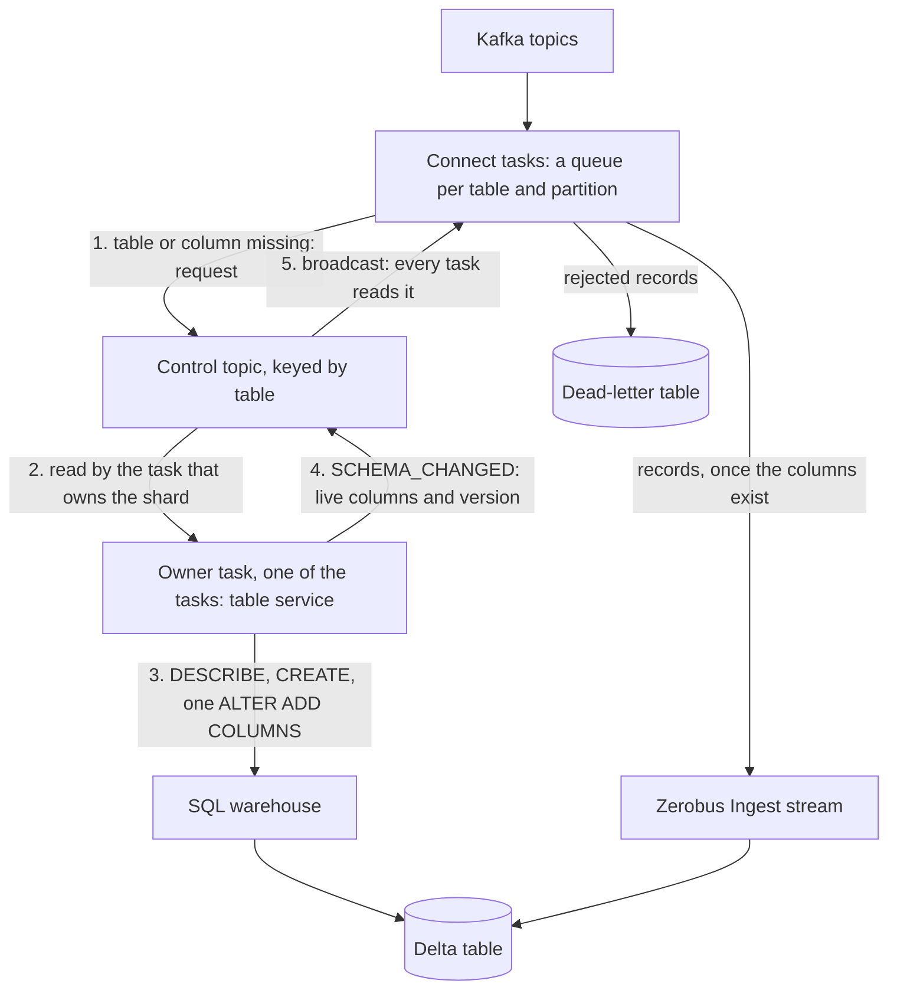

# Kafka Connect sink for Zerobus Ingest

A Kafka Connect sink connector that writes Kafka records to Delta tables through Zerobus Ingest. Version 0.6.0.

## Overview

- One connector runs many tasks. Each task owns some topic partitions and one stream per target table.
- Each record is routed to a table (a static fan-out, a regex on the topic, or a dynamic route field), mapped to columns (typed or envelope mode), and sent on a Zerobus stream (JSON or Arrow).
- Schema changes are additive. A task requests them. One table-service owner runs one `ALTER TABLE ... ADD COLUMNS` per table, and the waiting tasks resume.
- Offsets are committed only after the server acknowledges a record, or after the record is in the dead-letter table. Each record can be delivered more than one time (see Known limitations).
- A record the server or the mapping rejects can go to an optional dead-letter table, with its Kafka metadata.
- By default, every row carries a `_kafka` struct with the Kafka metadata, including `_kafka.timestamp` (the Kafka record timestamp).



## Prerequisites

- Docker with Compose (for the local Kafka and Connect stack) and the ability to run Maven in a container (Java 17) for the build.
- A Databricks workspace with Zerobus Ingest enabled, and its endpoint.
- A service principal (OAuth client ID and secret) with `USE CATALOG`, `USE SCHEMA`, and `SELECT, MODIFY` on the target and dead-letter tables. The grants are in `scripts/create_table.sql`.
- A SQL warehouse. It runs the table service (DESCRIBE, and CREATE or ALTER when auto-create or evolution is on). This example turns both off, so the warehouse is used for the dead-letter check at start and for the coverage query.
- For Arrow (`zerobus.format=arrow` or `auto`): typed mode and no rescue column. The worker runs with `--add-opens=java.base/java.nio=ALL-UNNAMED` (set in `compose/docker-compose.yml`).

## Configuration reference

Required: `zerobus.endpoint`, `zerobus.workspace.url`, `zerobus.client.id`, `zerobus.client.secret`, and a target (`zerobus.table`, `zerobus.topic2table.map`, or `zerobus.tables`). Put secrets in `.env` and refer to them as `${env:NAME}`.

### Topic selection

The connector reads the topics you list in the standard Kafka Connect sink settings. Set exactly one of the two keys:

| Key | Example | Meaning |
|---|---|---|
| `topics` | `"orders"` or `"orders,payments,refunds"` | One topic, or a comma-separated list. |
| `topics.regex` | `"events\\..*"` | A Java regular expression. Every topic whose full name matches is read, including topics created after the connector starts. Kafka picks up a new topic on the consumer's next metadata refresh (`metadata.max.age.ms`, 5 minutes by default), with no restart. |

One connector can read any number of topics. Each record is then written to a table by the routing rules in the next section:

- One table for every topic: set `zerobus.table`.
- One table per topic: set `zerobus.topic2table.map`, for example `events\\.(.*)=><catalog>.<schema>.events_$1` sends `events.orders` to `events_orders`. A topic that matches no rule goes to `zerobus.table`.
- Several tables from one topic: use the fan-out keys (`zerobus.tables` with a route field).

For example, to read every topic that starts with `events.` into one table per topic. Patterns are shown as they appear in the JSON config, where a backslash is written `\\`:

```json
"topics.regex": "events\\..*",
"zerobus.topic2table.map": "events\\.(.*)=><catalog>.<schema>.events_$1",
"zerobus.table.auto.create": "true"
```

### Routing

| Key | Default | Meaning |
|---|---|---|
| `zerobus.table` | none | Target table for every topic (or the default when no topic-map rule matches). |
| `zerobus.topic2table.map` | empty | `topic-regex=>catalog.schema.table_$1` rules, separated by `;`. The first full match wins. |
| `zerobus.tables` | empty | Static fan-out: a record is written to each listed table whose `route.regex` matches the route field. |
| `zerobus.tables.<catalog.schema.table>.route.regex` | none | Per-table pattern for static fan-out: a record goes to that table when its route field matches. |
| `zerobus.tables.route.field` | none | The field whose value is matched (or names the table when dynamic). |
| `zerobus.tables.dynamic.enabled` | false | The route field's value is the table name. |
| `zerobus.tables.dynamic.namespace` | none | The `catalog.schema` that dynamic routing may write to. |

### Mode and format

| Key | Default | Meaning |
|---|---|---|
| `zerobus.mode` | `typed` | `typed` (each schema field becomes a column) or `envelope` (fixed `record_key`, `record_value` VARIANT, headers, timestamp). |
| `zerobus.format` | `auto` | `json`, `arrow`, or `auto` (Arrow when every column type has an Arrow probe, otherwise JSON). |
| `zerobus.rescue.column.enabled` | false | Extra fields are captured by the server in a tagged rescue column. |
| `zerobus.metadata.enabled` | true | Adds the `_kafka` struct to the target table. |
| `zerobus.metadata.fields` | all six | Subset of `cluster,topic,partition,offset,key,timestamp` in `_kafka`. The default includes `timestamp`. |
| `zerobus.metadata.cluster.name` | empty | Name for `_kafka.cluster`. Empty means the Kafka cluster ID, read from `zerobus.kafka.bootstrap.servers`. |

### Tables and schema

| Key | Default | Meaning |
|---|---|---|
| `zerobus.table.auto.create` | false | Create missing tables through the table service (needs the warehouse). |
| `zerobus.schema.evolution.enabled` | false | Request additive `ADD COLUMNS` when a record has a field the table lacks. |
| `zerobus.table.service.mode` | `sharded` | `sharded` (each task owns the DDL for its tables) or `off`. |
| `zerobus.table.service.warehouse.id` | none | SQL warehouse for DDL and the dead-letter check. Required for evolution or auto-create. |
| `zerobus.control.topic` | `zerobus-connect-control` | Topic for table-service requests and change notices (needed with evolution or auto-create). |
| `zerobus.kafka.bootstrap.servers` | none | Kafka servers for the control topic and the cluster ID lookup. |
| `zerobus.schema.change.max.wait.ms` | 30000 | How long a record waits for a change before it fails. |

### Dead-letter table

| Key | Default | Meaning |
|---|---|---|
| `zerobus.dlq.table` | empty (off) | Dead-letter table, `catalog.schema.table`. Checked at start. |
| `zerobus.dlq.include.metadata` | true | Rows carry `cluster`, `topic`, `partition`, `offset`, `timestamp`, `headers`. |
| `zerobus.dlq.include.key` | false | Rows carry the record key (BINARY). Off by default to keep rows small. |
| `zerobus.dlq.oversize.metadata.only` | true | A record too large for Zerobus is written as its metadata only (`value` null, `value_truncated` true). Needs `zerobus.dlq.include.metadata=true`, and the connector refuses to start otherwise. `false`: such a record is logged as an error and not written; its offset still commits. |

### Other

| Key | Default | Meaning |
|---|---|---|
| `zerobus.arrow.batch.max.records` | 1000 | Records per Arrow batch (a batch is one offset). |
| `zerobus.arrow.open.threads` | 8 | Threads that flush and open Arrow streams on a schema change (0 = on the task thread). |
| `zerobus.max.inflight.records` | 50000 | Unacknowledged records per stream. |
| `behavior.on.null.values` | ignore | Tombstones (null values): `ignore` or `fail`. |

Set the worker's `offset.flush.interval.ms` to 500 for low commit latency (the value in `compose/connect-distributed.properties`).

## Dead-letter rows and the Zerobus record size limit

Dead-letter rows count against Zerobus's per-message size limit, the same as data rows. The documented limit is 10 MB (10,485,760 bytes). In testing, the server enforced 10,420,224 bytes. A record that is too large is rejected by the server with `Ingest payload too large`.

What the connector does for a record that is too large:

- The dead-letter row is kept under 9 MiB. If the row with its value would be larger, the value is left out and `value_truncated` is set to true. `value_original_bytes` gives the size the value had.
- With the default `zerobus.dlq.oversize.metadata.only=true`, the row keeps the Kafka metadata (when `zerobus.dlq.include.metadata` is on), so the record is still accounted for, as a metadata-only row in the dead-letter table.
- With `zerobus.dlq.oversize.metadata.only=false`, the record is not written at all. It is logged as an error with its coordinates, and its offset still commits. Use this only where losing the trace of an oversize record is acceptable.

To keep dead-letter rows small: leave `zerobus.dlq.include.key=false` (the default), and keep large payloads out of the record (for example, store the payload in object storage and send a reference).

## Schema

### Typed mode

Target table (the example in `scripts/create_table.sql`):

| Column | Type | Source |
|---|---|---|
| `id`, `name`, `amount` | BIGINT, STRING, INT | The record's schema fields (typed mode). |
| `_kafka` | STRUCT | `zerobus.metadata.enabled=true`. Fields: `cluster`, `topic`, `partition`, `offset`, `key`, `timestamp`. |
| `_kafka.timestamp` | TIMESTAMP | The Kafka record timestamp (CreateTime or LogAppendTime, as the broker stores it). |

### Envelope mode

With `zerobus.mode=envelope`, the table has a fixed shape, and the connector never adds columns to it. With `zerobus.table.auto.create=true`, the connector creates this table. If you create it yourself, use these columns:

```sql
CREATE TABLE IF NOT EXISTS <catalog>.<schema>.<table> (
  record_key STRING,
  record_value VARIANT,
  record_headers MAP<STRING, STRING>,  -- only with zerobus.envelope.headers.enabled=true (default)
  record_timestamp TIMESTAMP,
  _kafka STRUCT<cluster: STRING, topic: STRING, partition: INT, offset: BIGINT, key: STRING, timestamp: TIMESTAMP>  -- only with zerobus.metadata.enabled=true (default); fields as in zerobus.metadata.fields
);
```

| Column | Type | Written as |
|---|---|---|
| `record_key` | STRING | The record key as text (base64 for a byte key). Null when the record has no key. |
| `record_value` | VARIANT | The record value as JSON text. Null for a tombstone (a null value). |
| `record_headers` | MAP<STRING, STRING> | The record headers. Off when `zerobus.envelope.headers.enabled=false`. |
| `record_timestamp` | TIMESTAMP | The Kafka record timestamp. Null when the record has none. |
| `_kafka` | STRUCT | The Kafka metadata. Off when `zerobus.metadata.enabled=false`. |

Choose envelope when the shape of the payload varies or is not known in advance, when many topics write to one table, or when the producer does not send schemas. Fields are read from `record_value` in the query. Choose typed when each field should be a typed column that you can query directly. Typed tables can add new fields as columns (`zerobus.schema.evolution.enabled=true`). A field whose type differs from its column fails the record, unless the rescue column is on.

### Dead-letter table

Dead-letter table, all options on (`scripts/create_table.sql`):

| Column | Type | Written when |
|---|---|---|
| `cluster`, `topic`, `partition`, `offset` | STRING, STRING, INT, BIGINT | `zerobus.dlq.include.metadata=true` |
| `timestamp` | TIMESTAMP | metadata: the Kafka record timestamp |
| `key` | BINARY | `zerobus.dlq.include.key=true` |
| `value` | BINARY | every row (null for an oversize metadata-only row) |
| `value_original_bytes` | BIGINT | every row |
| `value_truncated` | BOOLEAN | every row |
| `headers` | MAP<STRING, STRING> | metadata |
| `error_message`, `failed_at`, `connector` | STRING, TIMESTAMP, STRING | every row |

Auto-create builds only the columns that the options enable. An existing dead-letter table must have every column that the options need. If one is missing, the connector fails at start and names the missing columns. The connector doesn't alter a dead-letter table.

## Example configurations

The `examples/` folder has one connector configuration for each common setup: one topic to one table with auto-create, fan-in from many topics into one envelope table, static and dynamic fan-out, and a dead-letter table. Each example was tested end to end. See [examples/README.md](examples/README.md) for when to use each one and the settings it depends on.

## Quick start

Run these from the folder that contains this README. You need Docker and a Databricks workspace.

1. Fill in the environment.

   ```bash
   cp .env.example .env
   ```

   Edit `.env`: the workspace URL and endpoint, the service principal's client ID and secret, the warehouse ID, and (for the check in step 7) `DATABRICKS_HOST` and a token. `.env` is git-ignored.

2. Create the tables. Replace the placeholders in `scripts/create_table.sql` (`<catalog>`, `<schema>`, `<service-principal-client-id>`) and run it in your SQL warehouse.

3. Build the connector. This runs the unit tests and stages the jar for compose.

   ```bash
   scripts/build.sh
   ```

4. Start Kafka and Connect.

   ```bash
   cd compose && docker compose up -d && cd ..
   ```

   Wait until `curl -s http://localhost:8083/` returns the worker's version.

5. Register the connector. Copy the example, replace its placeholders (`<catalog>`, `<schema>`), and register it.

   ```bash
   cp config.example.json config.json
   scripts/register.sh
   ```

   `register.sh` refuses a file that still has placeholders. Check the connector with `curl -s http://localhost:8083/connectors/zerobus-demo/status`. The connector and its task should be `RUNNING`.

6. Produce sample records. This creates the topic `demo_events` (three partitions) and sends 200 records.

   ```bash
   scripts/produce.sh demo_events 200 3
   ```

   Each record is JSON with a schema (`id`, `name`, `amount`). The connector writes them to `demo_events`.

7. Query the result and run the check. Query a few rows, then run the coverage check, which reads the end offsets from Kafka and checks every partition and offset in the table or the dead-letter table.

   ```sql
   -- in your SQL editor
   SELECT id, name, amount, _kafka.partition, _kafka.offset, _kafka.timestamp FROM <catalog>.<schema>.demo_events ORDER BY id LIMIT 5;
   ```

   ```bash
   # from this folder (DATABRICKS_HOST, SQL_WAREHOUSE_ID and a token or client credentials are read from .env)
   set -a && . ./.env && set +a
   python3 tests/at_least_once_check.py --topic demo_events \
     --table <catalog>.<schema>.demo_events --dlq <catalog>.<schema>.demo_events_dlq \
     --kafka-container kafka
   ```

   The check prints the expected coordinates, the rows in each table, missing, duplicates, and `RESULT at-least-once: PASS` when nothing is missing.

8. Stop. `cd compose && docker compose down`.

## How to extend

- **A new option**: Add a `define` and a getter in `ZerobusSinkConfig`, a validation rule if it depends on another option, and unit tests for every valid combination (see `TableColumnsTest` for the dead-letter matrix).
- **A new dead-letter column**: Add it to `TableColumns.DEAD_LETTER` and to `TableColumns.deadLetter(cfg)` under the option that enables it. The start check picks it up.
- **A new failure rule**: Handle it in the task's failure path (`attribute`, `failTarget`, `reject`), so that the record is delivered, dead-lettered, or skipped with a log line. The delivery tracker must see every record finish.
- **Tests**: `tests/run_unit_tests.sh` runs the unit suite in a Maven container. `tests/at_least_once_check.py` is the generic end-to-end coverage check.

## Known limitations

- (a) JSON converter coerces mismatched values to 0. Kafka's JSON converter (`connect-json`) turns a text value into `0` for an int32 field before the connector sees the record. A record that declares an integer field but carries "abc" is stored as `0`, with no error. The connector cannot see the original text. Use a strict converter (Avro or Protobuf with a schema registry), or schemaless JSON with the rescue column (`zerobus.rescue.column.enabled=true`), where extra and mismatched fields are kept on the server.
- (b) A record can be delivered more than one time. After a restart or a rebalance, records after the last committed offset are sent again, so the table can hold duplicates. To count each record one time, deduplicate on `_kafka.partition` and `_kafka.offset` (the dead-letter table has `partition` and `offset` too).
- (c) The rescue column is JSON only. Arrow is used only for typed tables without a rescue column. `zerobus.format=auto` falls back to JSON when a rescue column is set.

## Architecture



The worker commits a partition's offset only past records that are acknowledged or dead-lettered. The table service owns DDL, so each schema change runs one time per table.

### Control topic

The control topic (`zerobus.control.topic`, default `zerobus-connect-control`) is used only when schema evolution or auto-create is on. Create it before the connector starts, with at least as many partitions as tasks. Every message is keyed by table name, so all messages for one table go to one partition, and so to one owner.

**What is written.** Any task writes requests: `SNAPSHOT_REQUEST` (send the live schema of this table), `CHANGE_REQUEST` (add these columns), and `CREATE_REQUEST` (create this table with these columns). The owner writes `SCHEMA_CHANGED` after it handles a request. It carries the table's live columns and its Delta version.

**Who reads it.** Each task has two readers. The shard reader is a member of a consumer group per connector, so Kafka gives each task some of the partitions. A task handles the requests for the tables on its partitions, and it is the only task that runs DDL for them. The broadcast reader is not in a group. It reads every partition from the end of the topic, so every task sees every request and every `SCHEMA_CHANGED`. Because the broadcast reader starts at the end of the topic, each task asks for a snapshot of its tables at start instead of relying on older messages.

**How the owner handles them.** The owner groups a batch by table, so several requests for one table become one plan, and many requests for the same column cost one `ALTER TABLE`. For each table, it reads the live schema first. It creates the table if it is missing and a create was asked, then adds only the missing columns. A column that exists with another type is logged and left alone. "Already exists" counts as success, so a replayed batch does not add a column twice. Then it publishes `SCHEMA_CHANGED`. A transient SQL error is retried a few times with backoff. If a step still fails, nothing is published, and the requesters send again after their backoff. The owner commits the control offsets only after the batch is handled, so if it stops first, the next owner reads the batch again.

**What the other tasks do while one waits.** The task that holds the record keeps it in the queue for that table on that partition. The partition is not paused, so records for other tables and other partitions keep flowing. The other tasks see the same request on the broadcast reader, so they do not send a duplicate. A repeat goes out only after a backoff: 5 seconds at first, growing, and capped at `zerobus.schema.request.backoff.max.ms` (30 seconds by default). The wait ends when a `SCHEMA_CHANGED` shows the columns, and the queue sends. The offset of the partition does not move past a waiting record, because the record is not yet acknowledged. If the wait lasts longer than `zerobus.schema.change.max.wait.ms` (30 seconds by default), the record fails. If a queue holds `zerobus.schema.change.max.buffered.records` records (10,000 by default), its partition is paused until the queue drains.

**Rebalances.** If the owner stops, its control partitions move to another task after `zerobus.control.session.timeout.ms` (10 seconds by default). The new owner reads from the last committed control offset. When the Connect group rebalances, a task drops the unsent records of the partitions it loses, and the new owner replays them from the committed offset. A record can therefore be delivered more than one time (see Known limitations).

## Build and test

```bash
scripts/build.sh          # unit tests, then stage the jar under compose/plugins
tests/run_unit_tests.sh   # unit tests only, with the count
```

Set `MAVEN_SETTINGS=/path/to/settings.xml` if Maven must use a mirror. `M2_CACHE` sets the local Maven cache (default `~/.cache/zerobus-kafka-connect-m2`).
